# Community Complaint Tracker — Tests, Demonstration and Individual Explanation

## Project overview

The application tracks a resident's complaint from **Submitted → In Review → Resolved**. A resident submits a short description. The administrator assigned at deployment changes the status, and the submitter can view the resulting record. All accounts and transactions use local Ganache and test Ether.

## 1. Manual tests

Use the Ganache Windows app, web interface and MetaMask to perform these checks by hand. This table distinguishes supplied screenshot evidence from steps still to be documented.

| Manual check | Action and expected result | Supplied evidence |
| --- | --- | --- |
| Connect wallet | Connect a Ganache account; verify address, role and chain ID 1337 | Passed: Figures 5 and 12 show administrator and resident connected |
| Submit complaint | Enter a description, approve in MetaMask, verify Submitted and submission event | Passed: Figure 14 shows resident complaint #2 confirmed in block 16 |
| Review complaint | As administrator, approve Move to In Review; verify status and event | Passed: Figure 15 shows administrator review of resident complaint #2 in block 17 |
| Resolve complaint | As administrator, approve Move to Resolved and verify final status | Browser screenshot still needed |
| Resident reads complaint | Connect account 1, select My complaints and verify its own record | Partly documented: resident views its Submitted complaint in Figure 14; resident My complaints and Resolved view still needed |
| Reject blank/oversized input | Try spaces or over 280 ASCII letters; expect validation error and no new complaint | Manual evidence still needed; this checks interface validation |
| Reject unauthorized update | As resident, attempt updateStatus through an attached contract interaction GUI; expect Only administrator and unchanged state | Manual rejection/error screenshot still needed |

For the unauthorized check, attach the compiled contract to the current deployment address in a contract interaction GUI, connect resident account 1 through MetaMask and attempt `updateStatus` on an existing Submitted complaint with status value 1. Record the rejection and refresh the web app to verify unchanged state. A gas-estimation rejection is a rejected call; report a mined failed transaction only if a failed receipt exists. Detailed manual steps are in the [README](README.md#manual-tests-and-demonstration).

## 2. Demonstration and screenshot evidence

Keep Ganache open at `http://127.0.0.1:7545`, use chain ID **1337** and test Ether only. The GUI network ID **5777** is separate from the chain ID. Capture the account, complaint ID, status, transaction hash and event wherever available.

The Ganache screenshots below are historical transaction evidence from an earlier scripted run on contract `0x82bE84156B45DA8B20cb9ad9Fa3909F96d77b9e7`; they are retained as original app screenshots, not presented as manually executed tests. The later web app and MetaMask screenshots document the manual browser interaction on a separate deployment.

### Ganache GUI screenshots

The following original screenshots were captured in the Ganache desktop app. Their transaction hashes match the live demonstration results above. They show the mined blocks, senders, destination contract and gas used. These block detail pages do not display receipt status or decoded status changes; the outcome descriptions refer to the previously recorded receipt and state checks, rather than information visible on these block pages.

**Figure 1 — Resident submits complaint #2 (block 9).** The sender is resident account 1. The transaction hash matches the successful submission recorded in the demonstration.

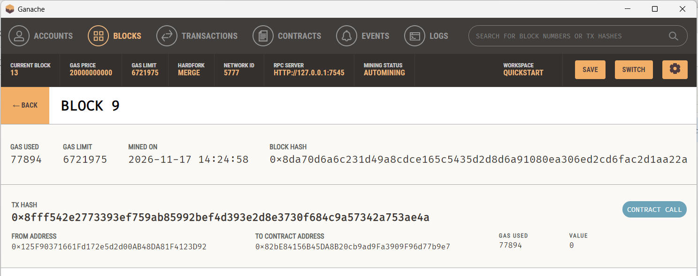

**Figure 2 — Unauthorized resident update (block 10).** The sender is again resident account 1. The matching transaction was verified to have receipt status 0, leaving the complaint Submitted. This screenshot establishes the transaction's inclusion in Ganache; the rejection outcome is established by the saved receipt check.

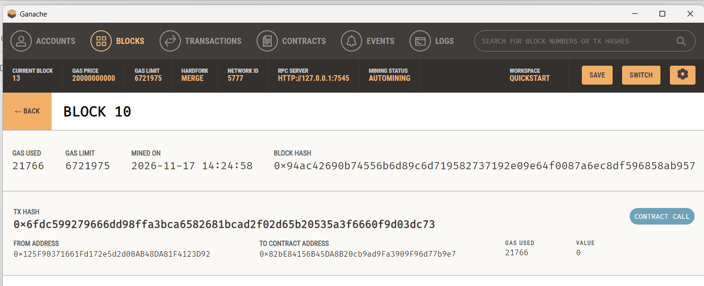

**Figure 3 — Administrator moves complaint to In Review (block 11).** The sender is administrator account 0. The matching transaction successfully advanced the complaint one step.

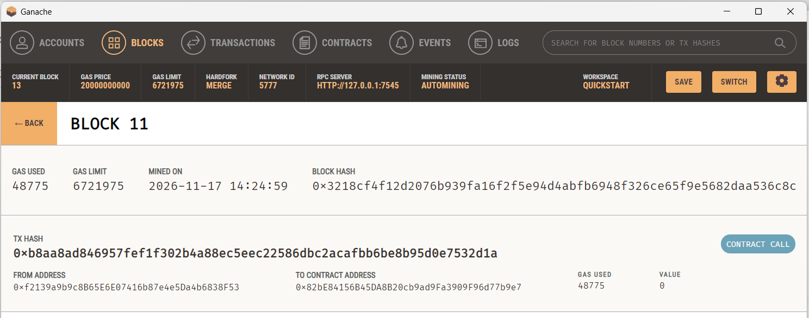

**Figure 4 — Administrator resolves complaint (block 12).** Administrator account 0 sent the final update. The demonstration subsequently confirmed that the resident could read Resolved.

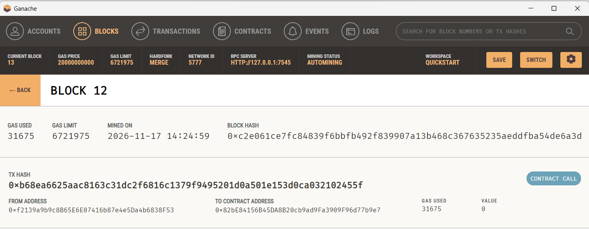

### Web interface and MetaMask screenshots

These original user-supplied screenshots document a later browser demonstration on contract `0x733F48294C25E1a8fc3caD9b3E9F92Ce23f8fA37`. This is a different deployment from the contract in the earlier Ganache block 9–12 demonstration. Complaint #1 was submitted by the administrator. The later screenshots also show resident account 1 submitting complaint #2 and the administrator advancing it to In Review, demonstrating use of two accounts. A resident permission rejection is not shown in this browser evidence.

**Figure 5 — Connected wallet and administrator role.** The interface displays the connected address, Administrator role, contract address and Ganache chain ID 1337, alongside MetaMask's matching account.

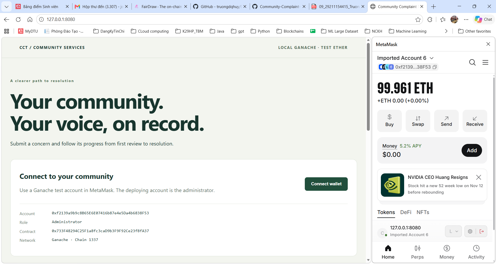

**Figure 6 — Submission awaiting wallet approval.** The description is entered and MetaMask displays a transaction request from the local web app. This is an approval request, not confirmation of a mined transaction.

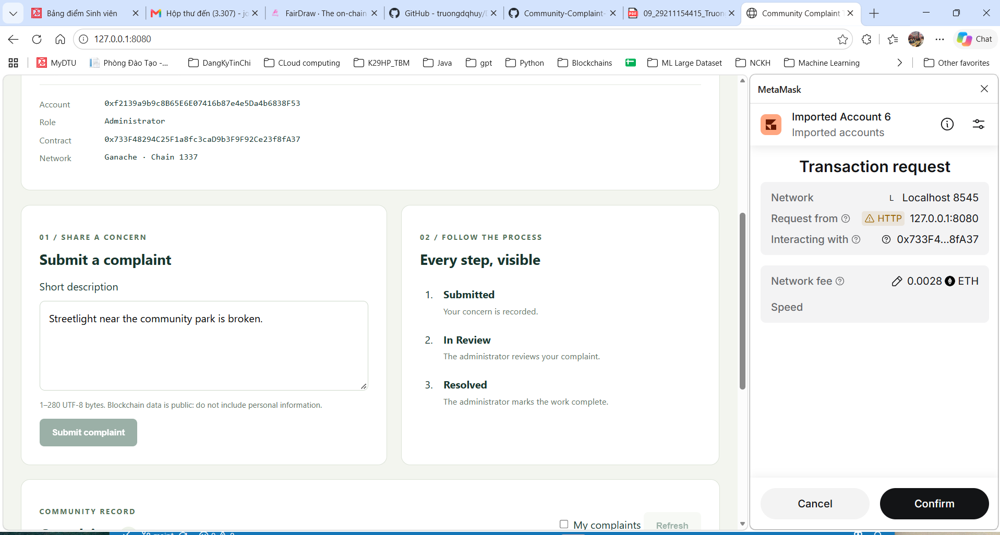

**Figure 7 — Successful submission.** The interface shows complaint #1 as Submitted, confirmation in block 14, the transaction hash and the submission event.

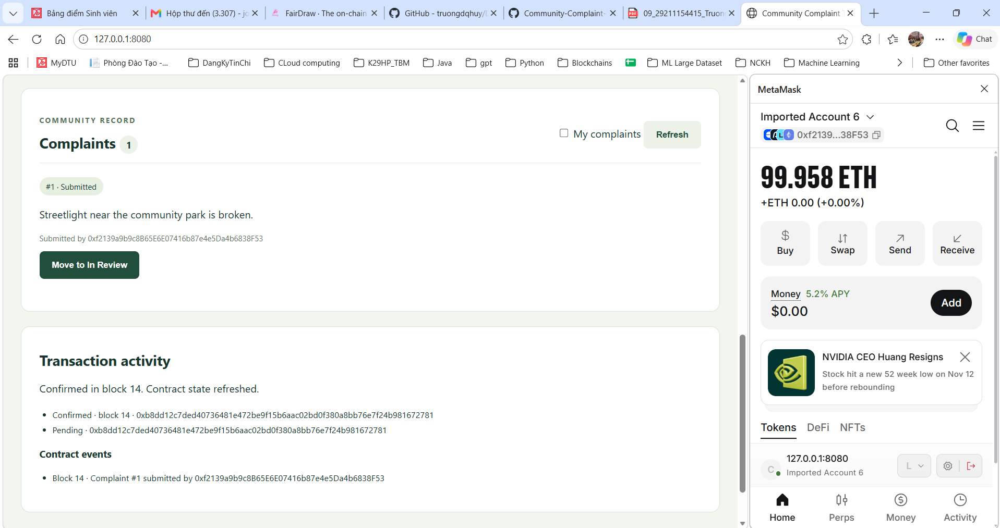

**Figure 8 — Status update awaiting wallet approval.** The complaint is still Submitted while the administrator approves the request to advance it to In Review.

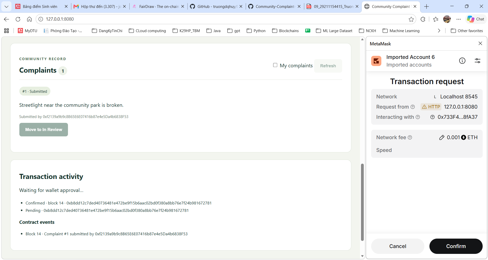

**Figure 9 — Successful review update.** The interface shows In Review, confirmation in block 15 and the Submitted → In Review event. The Move to Resolved button is available to the administrator.

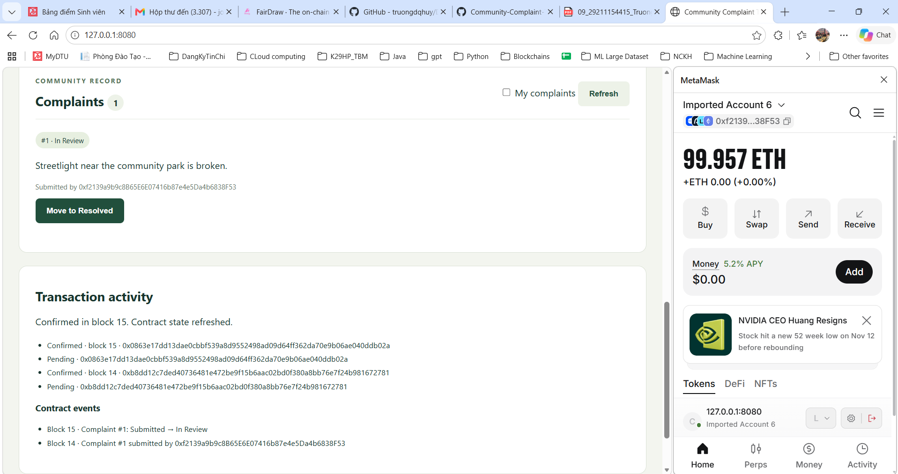

**Figure 10 — MetaMask confirms the review transaction.** MetaMask displays Confirmed for Imported Account 6 (`0xf2139...38f53`) on the network labeled Localhost 8545. The shortened transaction ID `0x0863e...db02a` matches the beginning and ending of the review transaction displayed in Figure 9. This provides wallet-side confirmation in addition to the web app's block 15 confirmation.

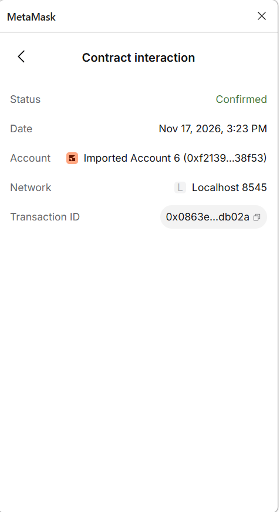

### Additional manual two-account evidence

**Figure 11 — Review confirmed in both interfaces.** Complaint #1 is In Review, with confirmation in block 15 and a matching Confirmed entry in MetaMask. This does not show resolution.

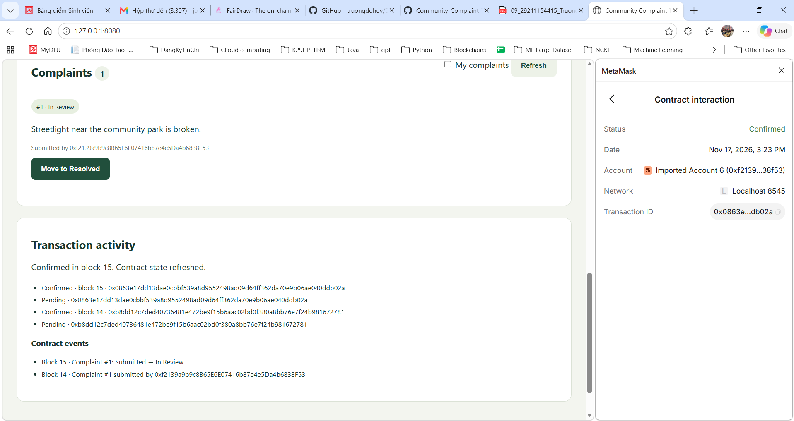

**Figure 12 — Resident connected.** Imported Account 7 matches Ganache account 1, `0x125F90371661Fd172e5d2d00AB48DA81F4123D92`. The web app displays Resident, the current contract and chain ID 1337.

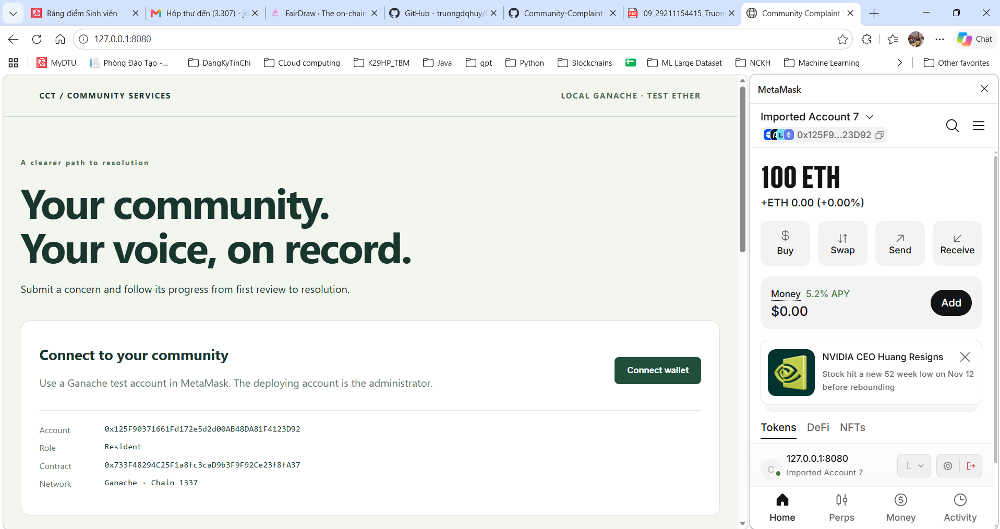

**Figure 13 — Resident requests submission.** The resident enters “Rubbish has not been collected near the community park.” MetaMask displays the transaction approval request. This image shows the request stage rather than confirmation.

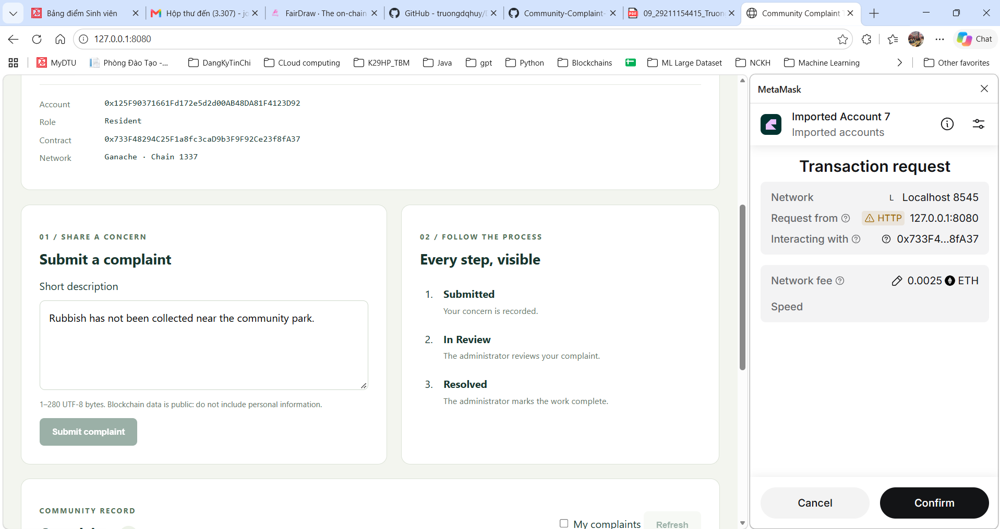

**Figure 14 — Resident submission confirmed.** Complaint #2 is Submitted with the resident address recorded as submitter. The web app confirms block 16, transaction `0x3c102b7d448b0ac79f8191fbc684fd3e9757870122543b358f118a65374b4712`. The resident can view the record and has no status-update buttons.

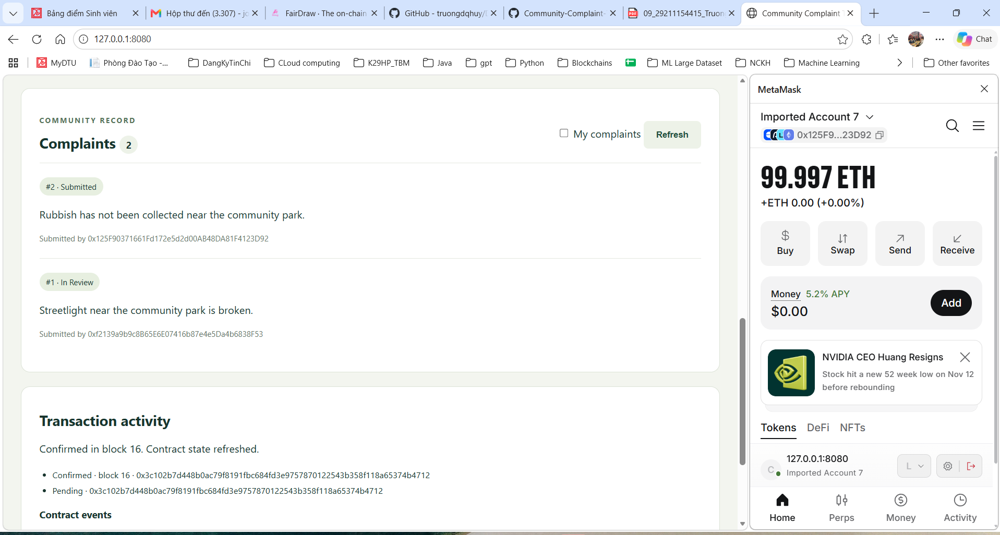

**Figure 15 — Administrator reviews resident complaint.** The event history records complaint #2 moving Submitted → In Review in block 17. MetaMask shows Confirmed for administrator Imported Account 6, matching transaction `0xbc20e950fa0cdbc6fca95a26969f294d3587a50e13b5482aee5631f750bf4eff`. The complaint #2 card is partly above the captured area; the event identifies the updated record.

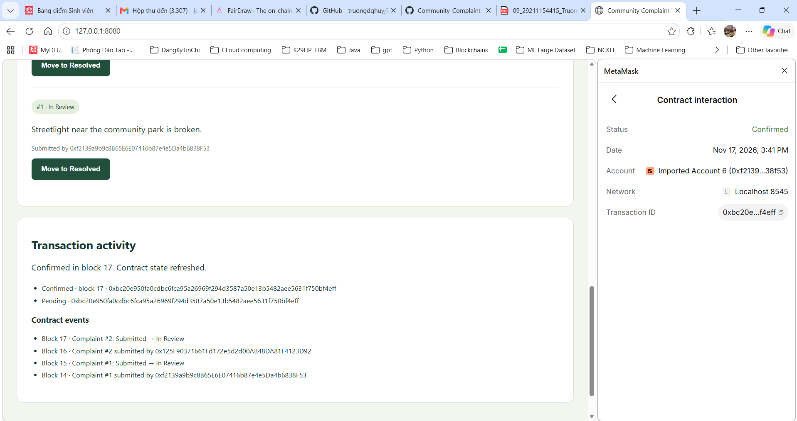

**Figure 16 — Administrator filters own complaints.** My complaints is selected while Imported Account 6, the administrator, is active. Only administrator-submitted complaint #1 is listed, still In Review. This demonstrates the administrator's own-record filter; it is not a resident view or evidence of Resolved.

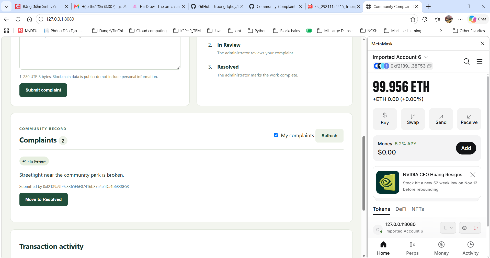

**Evidence limits:** MetaMask labels the selected network **Localhost 8545**, while the interface reports chain ID 1337. A network label alone does not establish the configured RPC port; check MetaMask's network settings against Ganache's `http://127.0.0.1:7545`. These screenshots now include MetaMask transaction details showing Confirmed. They show two connected accounts and resident submission followed by administrator review. They do not yet show a browser complaint reaching Resolved, the resident using My complaints to view the final state, or a manual rejected action. The earlier Ganache images are historical transaction evidence; completing the manual walkthrough requires the remaining browser and rejection screenshots.

### Interface demonstration checklist

The supplied browser screenshots above document wallet connection, approval requests, successful submission and advancement to In Review. The remaining workflow screenshots are complaint #2 Resolved and the resident viewing that final state through My complaints. A manual rejected invalid or unauthorized action also remains undocumented, as required by the assignment. MetaMask confirmation is shown in Figure 10. To complete the browser demonstration:

1. Keep Ganache GUI running. Run `npm start` and open `http://127.0.0.1:8080` in a MetaMask-enabled browser.
2. Connect Ganache resident account 1. Capture the connected address and submit a new complaint with test Ether.
3. Capture the confirmed transaction, Submitted record and submission event.
4. Switch to administrator account 0, reconnect, and capture In Review and Resolved after confirmation.
5. Switch back to resident account 1, reconnect, and capture the final status using My complaints.
6. Use the recorded unauthorized transaction or its Ganache receipt to show contract-level rejection. Hide mnemonics and private keys in every screenshot.

## 3. Individual explanation — review and adapt before submission

This section explains the implementation provided in this repository. Review the source and express your own understanding before submitting it as an individual assignment.

### Contract design

`ComplaintTracker.sol` stores each complaint under a numeric ID. A complaint contains the submitter address, description and status. IDs start at 1, and `complaintCount` tracks the number submitted. Descriptions must contain 1–280 UTF-8 bytes and cannot contain only the checked ASCII whitespace characters.

The contract obtains the submitter from `msg.sender`, rather than accepting an address supplied by the caller. This prevents a caller from attributing a complaint to another resident through a function argument.

The deploying address becomes the immutable administrator. Every status update checks that `msg.sender` equals this address. This project uses one assigned administrator for all complaints. The interface hides update buttons from residents, while Solidity independently enforces the permission.

The enum represents Submitted, In Review and Resolved as values 0, 1 and 2. An update must advance exactly one value. This prevents skipping review, repeating a status and moving backward. Resolved is final. Missing complaint IDs are rejected.

### Events and Web3 interaction

The contract emits `ComplaintSubmitted` for a new record and `StatusChanged` for each valid transition. The interface reads stored complaints for the current state and loads events for the activity history. It uses ethers.js and the wallet provider to request account access and sign transactions.

The interface displays the connected address, role, network and contract address. Transaction feedback covers wallet approval, pending hash, confirmed block and errors. The page reloads when the account or network changes to avoid retaining a signer for the previous account. Users reconnect after a switch.

### Deployment and testing choices

The deployment script compiles Solidity and deploys using unlocked Ganache account 0. It writes the ABI and deployed address into `web/deployment.json`. This avoids manually copying an ABI or using the unrelated address from the earlier Python storage example. The compiler targets the Paris EVM for compatibility with the Ganache GUI Merge hardfork.

Manual testing uses the Ganache desktop workspace and MetaMask accounts. The resident submits a complaint, the administrator advances its status, and the resident reads the result. A separate direct call through a contract interaction GUI checks unauthorized access independently of the hidden update buttons. Record each observed outcome and retain screenshots; do not mark uncompleted checks as passed.

### Limitations and learning points

Blockchain data is public, even when a Solidity mapping is declared private. Complaints should not include sensitive resident information. This demonstration loads all complaint records, so a larger application would need pagination. There is no administrator reassignment or complaint reopening. The contract records the administrator's resolution decision; it cannot independently verify real-world repairs.

The main concepts illustrated are address-based authorization, transaction reverts, sequential state transitions, event logs, wallet signing, and the difference between a read call and a state-changing transaction.

## 4. References

- [Solidity contracts and visibility](https://docs.soliditylang.org/en/latest/contracts.html)
- [ethers.js v6 documentation](https://docs.ethers.org/v6/getting-started/)
- [Ganache source and documentation](https://github.com/trufflesuite/ganache)
- Local implementation: [contract](contracts/ComplaintTracker.sol), [interface](web/index.html), [deployment](scripts/deploy.mjs).
